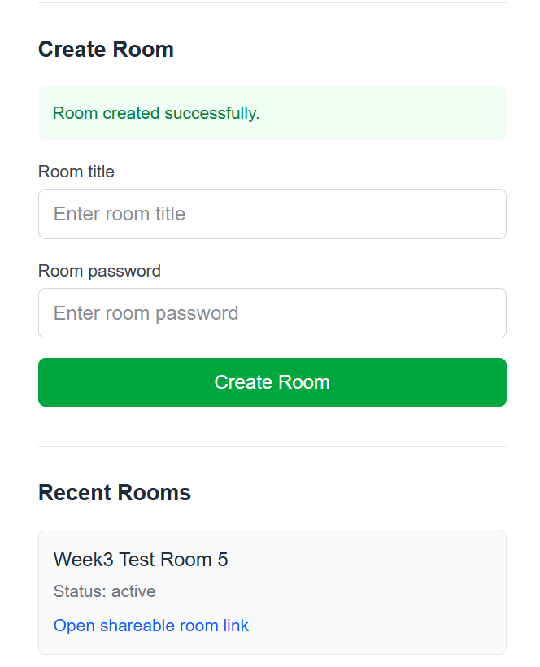
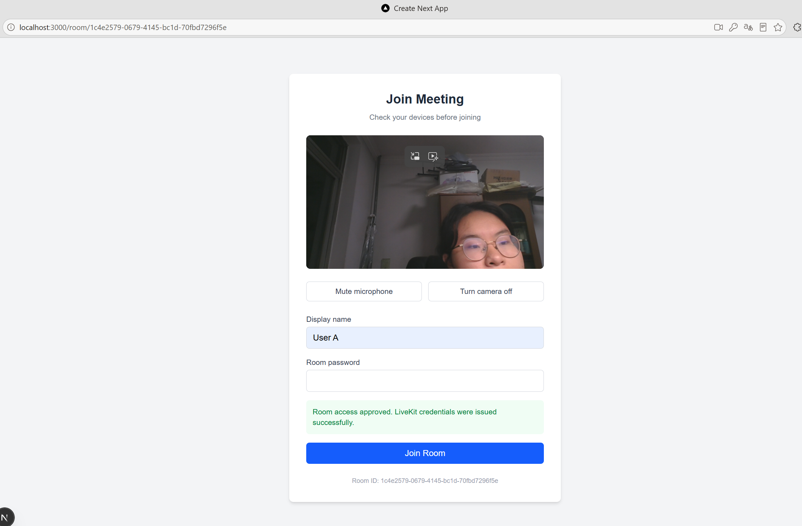
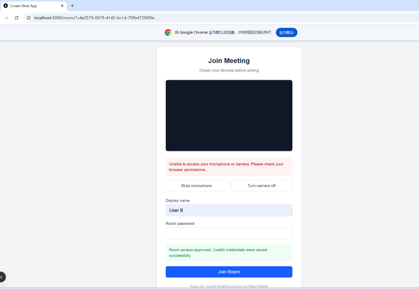

# Demo Evidence

## Shareable Room Link

The host created a room and received a shareable room link.

## User A

User A opened the invite link, entered the correct password, and received meeting credentials.

## User B

User B signed in using a separate browser profile and used the same invite link.

