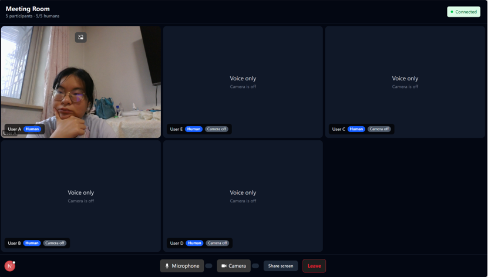
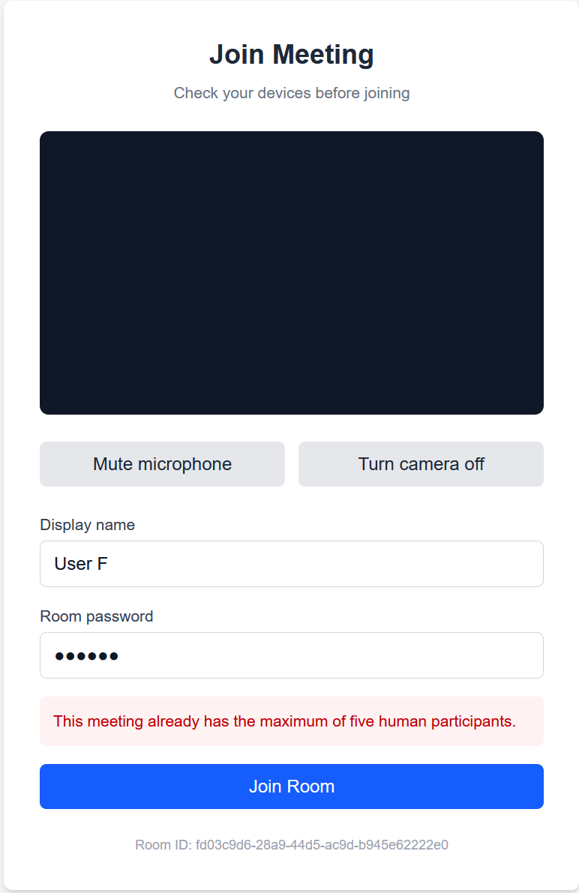

# Week 4 Testing

## Multi-Participant Meeting

- [x] Five authenticated human participants joined the same room.
- [x] Five participants could communicate through LiveKit.
- [x] A sixth human participant was rejected before joining.
- [x] Participant names and Human badges were visible.

## Media Controls

- [x] Microphone mute/unmute tested.
- [x] Camera on/off tested.
- [x] Voice-only participation tested with camera disabled.
- [x] Leave and rejoin tested.
- [x] Device selection UI tested.

## Connection and Errors

- [x] Temporary network interruption tested.
- [x] Reconnecting state was visible.
- [x] Permission errors were displayed without a blank page.

## Additional UI

- [x] Screen sharing tested.
- [x] Narrow mobile-size browser layout tested.

## Evidence

